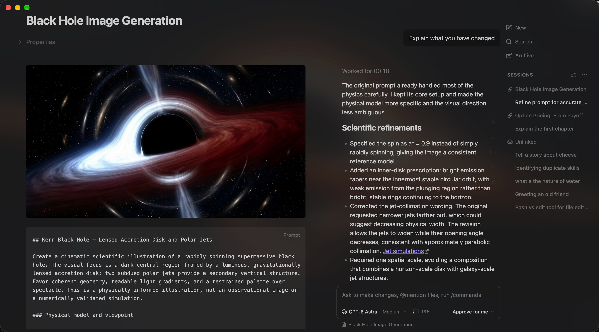
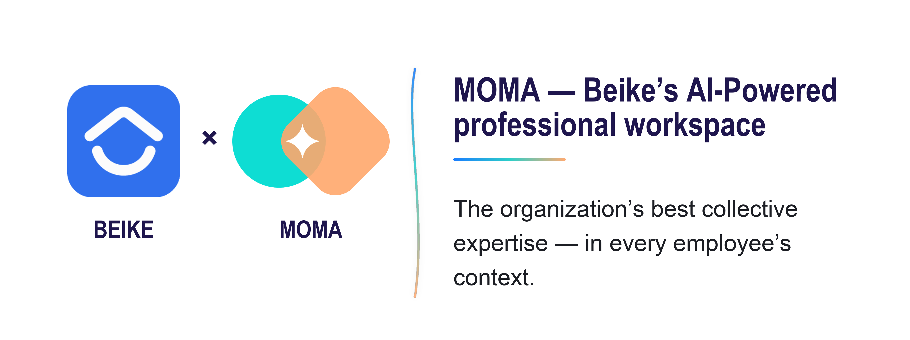

# Claudian

<p>
  <a href="https://trendshift.io/repositories/21115?utm_source=repository-badge&amp;utm_medium=badge&amp;utm_campaign=badge-repository-21115">
    
  </a>
  
  <a href="https://community.obsidian.md/plugins/realclaudian">
    
  </a>
  
  
  <br clear="both">
</p>



An Obsidian plugin that embeds AI coding agents (Claude Code, Codex, Grok Build, OpenCode, Pi, DeepSeek Harness, and more to come) in your vault. Your vault becomes the agent's working directory — file read/write, search, bash, and multi-step workflows all work out of the box.

## Features & Usage

Open Claudian interface from the ribbon icon or command palette. Everything works like your familiar coding agent, Claude Code, Codex, Grok Build, OpenCode, Pi, and DeepSeek Harness — talk to the agent, and it reads, writes, edits, searches and run commands in your vault.

**Inline Edit** — Select text or start at the cursor position + hotkey to edit directly in notes with word-level diff preview.

**Projects** — Group sessions that work toward a shared goal. Every member shares the project's instructions and a memory file that the agents keep current, and the agents can cooperate by finding, reading and messaging each other.

**Zen Mode** — Collapse the sidebar holding Claudian and the chat moves to a [compact composer](assets/zen-mode-collapsed.png) at the bottom of your notes, with a one-line activity preview and [the conversation one click away](assets/zen-mode-expanded.png).

**Slash Commands & Skills** — Type `/` or `$` for reusable prompt templates or Skills from user- and vault-level scopes.

**@mention** — Type `@` to reference vault files, folders and other Claudian sessions.

**Cross-Session Messaging** — Let agents read, message, steer or interrupt other Claudian sessions, or start new ones on any provider.

**Side Chat (`/side` or `/btw`)** — Explore a separate, temporary conversation with follow-ups and tools while keeping the main chat unchanged.

**MCP Servers** — Connect external tools through each coding agent's native CLI-managed MCP configuration.

**Tabs & Session Management** — Use multiple tabs in [single-pane mode](assets/main-chat-single-pane.png) or a persistent session manager beside the chat in [dual-pane mode](assets/main-chat-dual-pane.png).

**Plugin API (experimental)** — Let other Obsidian plugins send prompts to sessions, stop them and read their replies. See the [Plugin API guide](docs/plugin-api.md).

**Collaboration** — Collab is now a standalone plugin. See [Claudian Collab](https://github.com/YishenTu/claudian-collab).

## Requirements

- At least one of the following harnesses:
  - [Claude Code](https://code.claude.com/docs/en/overview)
  - [Codex](https://github.com/openai/codex)
  - [DeepSeek Harness](https://github.com/deepseek-ai/deepseek-harness)
  - [Grok Build](https://github.com/xai-org/grok-build)
  - [OpenCode](https://github.com/anomalyco/opencode)
  - [Pi](https://github.com/earendil-works/pi)
- A compatible subscription or API provider
- Obsidian v1.13.0+
- Desktop only (macOS, Linux, Windows)

Claudian now supports OpenCode v2, OpenCode v1 support will end on October 30, 2026. See the [OpenCode v2 migration guide](https://opencode.ai/v2/docs/migrate-v1).

## Installation

### From Obsidian Community Plugins (recommended)

1. Open Obsidian → Settings → Community plugins → Browse
2. Search for "Claudian" and click Install
3. Enable the plugin

Or install directly from the [community plugin page](https://community.obsidian.md/plugins/realclaudian).

### From source (development)

1. Clone this repository into your vault's plugins folder:
   ```bash
   cd /path/to/vault/.obsidian/plugins
   git clone https://github.com/YishenTu/claudian.git realclaudian
   cd realclaudian
   ```

2. Install dependencies and build:
   ```bash
   npm install
   npm run build
   ```

3. Enable the plugin in Obsidian:
   - Settings → Community plugins → Enable "Claudian"

### Development

```bash
# Watch mode
npm run dev

# Production build
npm run build
```

## Privacy & Data Use

- **Sent to API**: Your input, attached files, images, and tool call outputs. Depending on the selected provider, data is sent to Anthropic (Claude), OpenAI (Codex), xAI (Grok), or the providers configured in OpenCode, Pi, or DeepSeek Harness. The destination can be configured through provider settings and environment variables.
- **No telemetry or unsolicited background activity**: Claudian does not run telemetry beacons. UI polling timers read local Obsidian/editor selection state only. Network activity is limited to explicit provider runtime work, configured MCP endpoints, a 127.0.0.1-only listener that OpenCode, DeepSeek and Grok sessions use for Claudian's session tools, provider SDK/CLI calls needed to answer your requests, and their configured services.

## Troubleshooting

The following sections use Claude Code as an example.

### Provider CLI not found

If Claudian cannot auto-detect a provider CLI, verify that the CLI is installed and available through PATH. Typical errors include `spawn claude ENOENT` and `Claude Code CLI not found`.

On macOS and Linux, Obsidian launched from the Dock or a desktop entry does not inherit your terminal's PATH, so Claudian reads PATH once from your login shell (`$SHELL -i -l`). CLIs and Node.js installed through version managers such as nvm, fnm, Volta, asdf, or mise are found the same way your terminal finds them. Reload Claudian after changing your shell profile. If your profile is slow or interactive, skip that part when `CLAUDIAN_RESOLVING_ENVIRONMENT` is set; Claudian falls back to common install locations if the shell does not answer within 10 seconds.

On Windows, Obsidian uses the PATH from your user and system environment variables. Restart Obsidian after changing them.

Leave the CLI path setting empty first so Claudian can auto-detect the CLI. If auto-detection fails, find the executable path, open Settings → Claudian → Providers → Claude Code, expand the Claude Code installation card, and set Claude Code CLI path.

For Codex on macOS, auto-detection also checks ChatGPT.app in `/Applications` and `~/Applications`, including its nested `codex-cli/CodexCLI.app` runtime. A configured CLI path or shared PATH entry takes precedence.

| Platform | Command | Example Path |
|----------|---------|--------------|
| macOS/Linux | `which claude` | `/Users/you/.volta/bin/claude` |
| Windows (native) | `where.exe claude` | `C:\Users\you\AppData\Local\Claude\claude.exe` |
| Windows (npm) | `npm root -g` | `{root}\@anthropic-ai\claude-code\cli-wrapper.cjs` |

> **Note**: On Windows, avoid `.cmd` and `.ps1` wrappers. Use `claude.exe` for native installs, or `cli-wrapper.cjs` for package-manager installs. `cli.js` is only a legacy fallback for older Claude Code npm packages.

**Alternative**: Add your Node.js bin directory to PATH in Settings → Claudian → General → Environment → Shared environment.

### A newly released model is missing

Claudian discovers models from each configured provider rather than keeping its own hard-coded model list. A model can therefore be available through a provider API or announced publicly before it appears in the catalog returned for your provider installation, configuration, and account.

1. Update the provider CLI or application, when applicable, and confirm the model appears there.
2. In Settings → Claudian → Providers, open the provider and confirm its CLI path, environment, and other connection settings use the same installation and account.
3. Under **Models**, open **Browse models**, then click **Refresh** if models are already listed, or **Discover** otherwise, to request the current catalog.
4. Enable the new model and start a new chat if you want to use it. Existing chats keep their selected model.

If the model is still absent, the active provider runtime or account has not reported it to Claudian. Public or API availability alone does not guarantee catalog availability for every provider integration or account. Avoid editing Claudian's installed bundle to add the model manually; those changes are unsupported and will be overwritten by updates.

For OpenCode, discovery failures show the request error, including a server error reference when supplied. A successful catalog with no enabled models instead shows configuration guidance. Check the vault's `.opencode/opencode.json`, compare `opencode models --standalone` from that vault using the same CLI and environment, and use `opencode debug paths` to locate OpenCode logs. With OpenCode v2, configured V1 plugins may be incompatible; an empty catalog alone does not establish a plugin failure.

### Node.js not found for an npm-installed CLI

npm-installed provider CLIs need Node.js. Claudian prefers the Node.js next to the CLI, then the first one on PATH. If the CLI still reports that Node.js is missing (for example `env: node: No such file or directory`), check where your terminal finds it:

```bash
dirname "$(which node)"
```

Either:

1. Install the native binary (recommended).
2. Add that directory in Settings → Claudian → General → Environment → Shared environment: `PATH=/path/to/node/bin`.

### Authentication fails while the CLI subscription works

Claude can report `authentication_failed` inside Obsidian while the selected CLI works with a subscription in a terminal. An `ANTHROPIC_API_KEY` or `ANTHROPIC_AUTH_TOKEN` inherited from the system environment takes precedence over subscription sign-in, so pointing Claudian at another CLI path does not help. The chat error includes the same recovery steps.

In Settings → Claudian → Providers → Claude Code → Environment → Custom variables, add an empty assignment for the conflicting credential so Claude falls back to the subscription:

```env
ANTHROPIC_API_KEY=
```

Use `ANTHROPIC_AUTH_TOKEN=` instead when that is the inherited credential. Override only credentials you intend to disable, and keep these assignments out of the shared environment so other providers are unaffected.

When asking for help, share the variable names involved rather than their secret values.

### More help

For provider-specific installation and configuration guidance, refer to the provider documentation linked in the [Requirements](#requirements) section. If you have a feature request or run into a bug, please [submit a GitHub issue](https://github.com/YishenTu/claudian/issues).

## Architecture

```
src/
├── main.ts                      # Plugin entry point and sole composition root
├── composition/                 # Host objects and view wiring shared by app and features
├── app/                         # Startup, conversations, settings, and storage
├── core/                        # Provider-neutral execution, registry, and type contracts
│   ├── execution/               # Run, session snapshot, and interaction primitives
│   ├── providers/               # Provider registry and workspace services
│   ├── process/                 # CLI discovery and managed child processes
│   ├── prompt/                  # Prompt and context encoding
│   ├── auxiliary/               # Shared provider auxiliary services
│   └── ...                      # bootstrap, commands, rpc, security, storage, tools, types
├── providers/
│   ├── claude/                  # Claude Agent SDK adaptor, native history, plugins
│   ├── codex/                   # Codex shared app-server adaptor, JSON-RPC, JSONL history
│   ├── deepseek/                # DeepSeek Harness native Remote adaptor, presets, and history
│   ├── grok/                    # Grok Build ACP adaptor, native history, models, and tools
│   ├── opencode/                # OpenCode ACP and HTTP adaptors, shared server
│   ├── pi/                      # Pi RPC adaptor, model discovery, JSONL history
│   └── acp/                     # Agent Client Protocol shared mechanics
├── features/
│   ├── agent-skills/            # Vault skill and Claude command management
│   ├── chat/                    # Sidebar chat: tabs, workspace lifecycle, controllers, renderers
│   ├── inline-edit/             # Inline edit modal and provider-backed edit services
│   └── settings/                # Settings shell and provider tabs
├── shared/                      # Reusable UI components, settings controls, mention/dropdown
├── i18n/                        # Internationalization (10 locales)
├── utils/                       # Domain-free leaf helpers
└── style/                       # Modular CSS
```

## Contributing

Issues and focused pull requests are welcome. Issues are the preferred starting point: describe the problem, reproduction steps, and environment clearly so it can be investigated.

Before opening a pull request, please read the [contribution guide](CONTRIBUTING.md). Pull requests must explain the problem, the proposed solution, why the approach is appropriate, and how the change was validated. Pull requests that add a new provider are not accepted; the guide explains this maintenance and product-quality boundary in detail.

## Star History

<a href="https://www.star-history.com/?repos=YishenTu%2Fclaudian&type=date&legend=top-left">
 <picture>
   <source media="(prefers-color-scheme: dark)" srcset="https://api.star-history.com/chart?repos=YishenTu/claudian&type=date&theme=dark&legend=top-left&sealed_token=UAS9n3qO4GyhCCkOr9kcAl7msVtDEz-DoQTkpFuPrAELxMEK9PQWj9zG566afbx0CkF5OoIbLRkxiDIoMRCK5Q-HXbLUiimg1lT8wKDdcc_eP48_EodHFrR6UtY8jS7Mzik4lLd_sY8oVj2I42lISFB1tSlr4gnXwOCNwtTn6iQakbru7yKPIO3uVYpP" />
   <source media="(prefers-color-scheme: light)" srcset="https://api.star-history.com/chart?repos=YishenTu/claudian&type=date&legend=top-left&sealed_token=UAS9n3qO4GyhCCkOr9kcAl7msVtDEz-DoQTkpFuPrAELxMEK9PQWj9zG566afbx0CkF5OoIbLRkxiDIoMRCK5Q-HXbLUiimg1lT8wKDdcc_eP48_EodHFrR6UtY8jS7Mzik4lLd_sY8oVj2I42lISFB1tSlr4gnXwOCNwtTn6iQakbru7yKPIO3uVYpP" />
   
 </picture>
</a>

## Sponsorship

### Kimi (Moonshot AI)


Thanks Kimi (Moonshot AI) for supporting Claudian! Try a **Kimi Code plan** ([CN](https://www.kimi.com/code?aff=claudian) | [Global](https://www.kimi.ai/code?aff=claudian)), or use the **API** through the Kimi Open Platform ([CN](https://platform.kimi.com?track_id=track-8415973bd2f5424dadf3cee1cdbacaca&aff=claudian) | [Global](https://platform.kimi.ai?track_id=track-39fcfe097e114d8b8ca8fbcd1abf7266&aff=claudian)). New users receive bonus API credits equal to 10% of their first successful top-up. This offer ends December 31, 2026. Claudian receives no affiliate commission from these links.

### Ke Holdings Inc. (BEIKE)



Claudian is proudly sponsored by Ke Holdings Inc. (BEIKE) and the MOMA team. Their support helps Claudian continue to improve through ongoing development and maintenance.

> Want to support Claudian or appear here? Contact me: [tysk01213@gmail.com](mailto:tysk01213@gmail.com).

## License

Licensed under the [MIT License](LICENSE).
