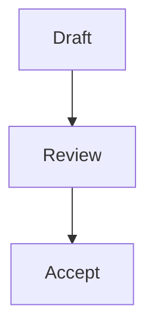

# Code blocks and diagrams in chat

## Copy code

Fenced code blocks in chat display their language label and the original code.
Click the language label or the code block's copy control to copy its contents.
The control briefly shows **Copied!** after the clipboard write succeeds.

Ordinary code fences display as code, including languages that an installed
Obsidian plugin would render specially in a note. To let a plugin render a
language in chat, configure it as described below.

## Mermaid diagrams

Claudian renders completed `mermaid` fences with Obsidian's bundled Mermaid
renderer. For example:

````markdown

````

By default the diagram is shown as an image. Mermaid click callbacks are not
interactive in that image. Choose **Show diagram source** to inspect and copy
the underlying code; moving focus outside the source panel returns to the
image. If the diagram cannot render, its source code remains available.

While the text block is streaming, the fence remains code. The diagram renders
when that block completes. Mermaid does not need an entry in the plugin-language
setting below for this default behavior.

## Render a fence with an installed plugin

1. Confirm that the desired language already renders in a note with its
   corresponding Obsidian plugin enabled.
2. Open **Settings → Claudian → General → Display**.
3. In **Fence languages rendered by plugins**, enter the fence language names,
   one per line. For example, a plugin that renders `vega-lite` fences needs:

   ```text
   vega-lite
   ```

4. Leave the field to finish saving the edit.

Language matching ignores capitalization and surrounding whitespace. Use the
language name written after the opening fence, rather than a plugin's display
name. The field starts empty; adding a language delegates those chat fences to
the registered Obsidian code-block processor. It does not install a renderer.

Configured languages stay as code while a text block is streaming and render
when that block completes. Other code fences continue to display as code. This
setting applies to chat message rendering.

If a configured block still appears as code, check that the fence is complete,
its language matches an entry, and the renderer plugin is enabled. If Mermaid
falls back to code, check the diagram syntax against the Mermaid version bundled
with your Obsidian installation.
